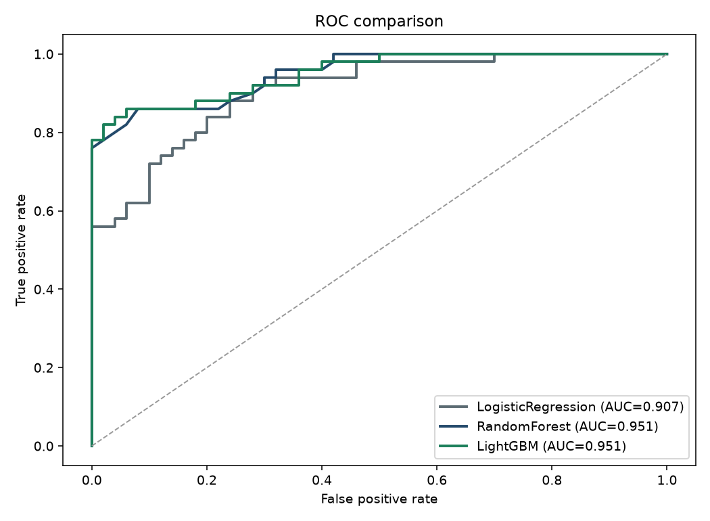
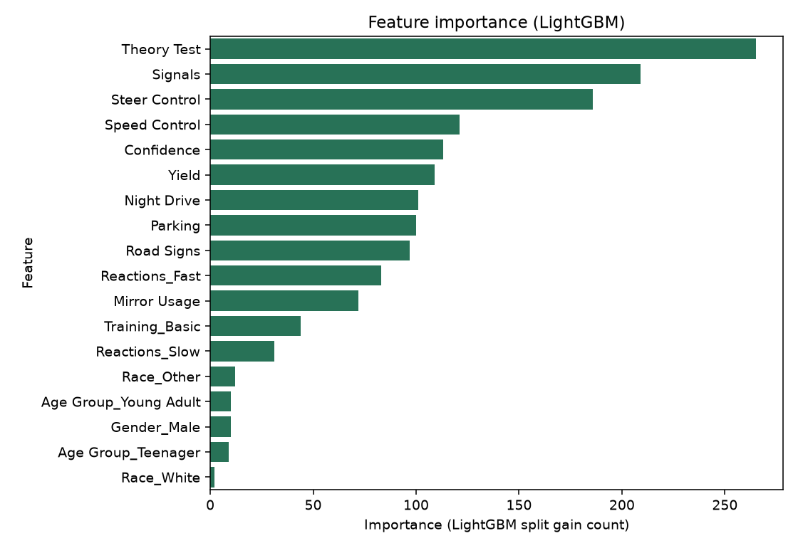

# Drivers License Test Scores — Qualification Prediction

[](https://huggingface.co/spaces/waleedarif1011/driver-license)
[](https://github.com/waleedarif1011/driver-license/actions/workflows/ci.yml)
[](LICENSE)

Predict whether a driver's license applicant is **Qualified** from demographics, training level, reactions, and practical / theory test scores. The repo ships a three-model classification benchmark (Logistic Regression, Random Forest, LightGBM), a saved LightGBM artifact, and a live **Driver Qualification Predictor** Gradio demo.

> **Live demo:** after the Hugging Face Space is created (see [Deploy](#deploy-hugging-face-space)), open the badge URL above. Until then, run locally with `python app.py`.

## Results (held-out 20%, `random_state=42`)

| Model | Accuracy | Precision | Recall | F1-score | ROC-AUC |
|-------|----------|-----------|--------|----------|---------|
| Logistic Regression | 0.820 | 0.808 | 0.840 | 0.824 | 0.907 |
| Random Forest | 0.880 | 0.896 | 0.860 | 0.878 | 0.951 |
| **LightGBM** | **0.890** | **0.915** | **0.860** | **0.887** | **0.951** |

`LightGBM` is the exported model. Full numbers: [`artifacts/metrics.json`](artifacts/metrics.json).

### ROC comparison & feature importance





## Quickstart

```bash
python -m pip install -r requirements.txt
python -m src.train          # train + write artifacts/ and assets/
python app.py                # Gradio demo at http://127.0.0.1:7860
```

Refresh the bundled sample (optional):

```bash
python scripts/fetch_data.py
```

### CLI inference

```bash
python -m src.predict \
  --gender Female --age-group "Young Adult" --race Other \
  --training Advanced --reactions Fast \
  --signals 80 --yield 75 --speed-control 78 --night-drive 72 \
  --road-signs 80 --steer-control 85 --mirror-usage 70 \
  --confidence 75 --parking 82 --theory-test 92
```

Returns JSON with `badge`, `probability`, and top contributing factors.

## Method (short)

- **Data:** `data/driver_license_sample.csv` — 500 applicants matching the notebook schema (synthetic stand-in for the Kaggle CSV so CI needs no external download).
- **Cleaning:** impute missing `Training` with the mode; coerce numeric score columns.
- **Features:** drop `Applicant ID`; one-hot encode `Gender`, `Age Group`, `Race`, `Training`, `Reactions` with `drop_first=True` (same encoding as the original notebook).
- **Split:** 80/20 stratified train/test (`random_state=42`).
- **Models:** Logistic Regression (`liblinear`), Random Forest, LightGBM — LightGBM exported to `artifacts/driver_lgbm.joblib`.
- **Demo:** Gradio form with demographics + score sliders and 3 held-out presets (borderline / average / strong).

## Exploratory findings (from the notebook)

* Applicants who qualified generally scored higher on practical components, especially Signals, Steer Control, Parking, and Theory Test.
* Advanced training and Fast reactions correlate with higher qualification rates.
* Gender and Race distributions are relatively balanced vs qualification in this sample.

## Tests & CI

```bash
python -m pytest -q
```

GitHub Actions runs the same suite on every push/PR (`.github/workflows/ci.yml`).

## Deploy (Hugging Face Space)

This repo is Space-ready (`app.py` + Gradio README frontmatter). Create and push:

```bash
# once: huggingface-cli login   # needs a write token with Spaces scope
huggingface-cli repo create driver-license --type space --space_sdk gradio -y
git remote add space https://huggingface.co/spaces/waleedarif1011/driver-license
git push space HEAD:main
```

Step-by-step: [`docs/hf-space-deploy.md`](docs/hf-space-deploy.md).

## Layout

```
app.py                 Gradio Driver Qualification Predictor (3 presets)
src/features.py        clean + one-hot encode matching the notebook
src/train.py           LR / RF / LightGBM + metrics/plots
src/predict.py         CLI + probability + top factors
data/                  driver_license_sample.csv
artifacts/             driver_lgbm.joblib + metrics.json
assets/                roc_comparison + feature_importance plots
notebooks/             exploratory notebook (local data path)
scripts/fetch_data.py  regenerate the sample CSV
tests/                 pytest suite
```

## License

MIT — see [`LICENSE`](LICENSE).
